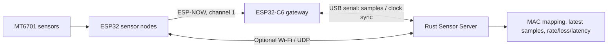
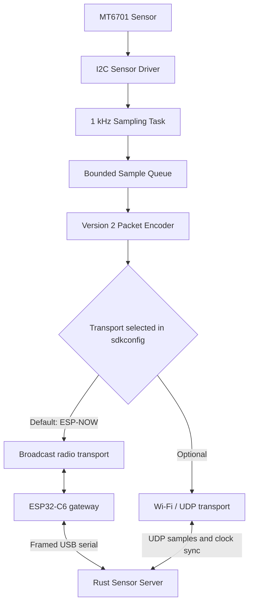
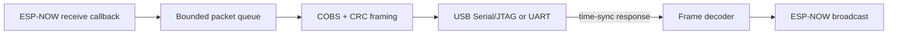
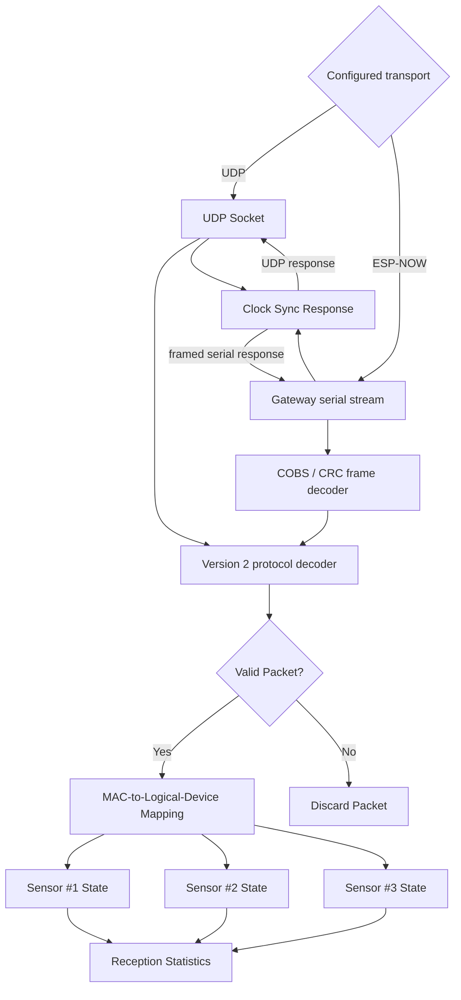
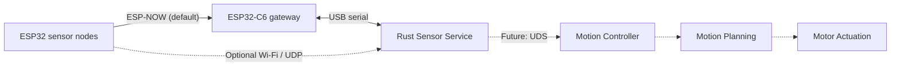

# Sensor System Architecture

## System Overview

The system consists of ESP32 sensor nodes, each connected to an MT6701 magnetic angle sensor and targeting 1000 samples per second. ESP-NOW is the default transport. An ESP32-C6 gateway forwards packets over native USB serial to the Rust Sensor Server. Wi-Fi / UDP remains selectable in sensor sdkconfig and server configuration.

The firmware, gateway and server build independently and implement their own transport code. The `protocol/` directory contains documentation only, including the wire contract and serial framing. The gateway does not rewrite sensor timestamps or identify nodes with its own MAC.

In the server configuration, `[server] mode = "espnow"` selects gateway serial and `[gateway] serial = "path"` selects the host device. `mode = "udp"` selects direct UDP. In sensor sdkconfig, `CONFIG_SENSOR_ESPNOW=y` is the default and excludes the Wi-Fi AP connection, reconnect task and UDP code; the Wi-Fi radio driver remains required by ESP-NOW.

The sections below describe each transport, the shared protocol, and the server's common state and statistics path.

## Sensor Firmware Architecture

Each supported sensor board runs the same firmware. Its station MAC identifies the node in every sample. A compile-time sdkconfig option selects ESP-NOW (the default) or Wi-Fi / UDP.

### Responsibilities

- **Sensor driver:** Reads the raw 14-bit angle value from the MT6701 over I2C.
- **Sampling task:** Uses a 1 ms high-resolution timer to target 1000 samples per second.
- **Sample queue:** Decouples sensor reads from transport submission. Samples can be dropped when the bounded queue fills or the selected transport is unavailable.
- **Packet encoder:** Encodes samples and clock-sync requests using the version 2 contract in [`protocol/protocol.md`](../protocol/protocol.md), including the station MAC and clock-sync metadata.
- **ESP-NOW transport:** Sends broadcasts on the configured channel and queues matching sync responses from the gateway. It needs the Wi-Fi radio driver, but does not start an access point connection, IP stack, or UDP application code.
- **Optional UDP transport:** Connects to a configured access point, reconnects after disconnects, and sends packets to the configured server address.
- **Clock-sync client:** Exchanges monotonic timestamps about once per second over the selected transport and attaches the estimated server-clock offset and round-trip time to samples.

## ESP-NOW Gateway Architecture

The gateway runs on an ESP32-C6 and bridges version 2 packets between the sensor radio and the server serial port. It checks that each received sensor payload's MAC matches the radio source, then frames it with COBS and CRC-16/CCITT-FALSE. Responses from the server are decoded and broadcast back to the sensors; each sensor accepts only its own matching time-sync response.

Radio callbacks only enqueue packets. Dedicated tasks handle each serial direction, keeping serial writes out of the radio receive callback.

## Rust Sensor Server Architecture

The Rust Sensor Server receives packets through either a UDP socket or the ESP-NOW gateway's serial stream. Both inputs use the same version 2 decoder, MAC mapping, device state, clock-sync handling, and statistics.

### Responsibilities

- **Transport receiver:** Opens the configured UDP address or serial device. Serial input handles fragmented and concatenated frames and rejects invalid CRC or oversized frames.
- **Protocol decoder:** Parses the fixed-length binary packets after transport framing is removed.
- **Clock-sync handler:** Replies to configured nodes with receive/send timestamps and the current server-session ID. In ESP-NOW mode, the response travels back through serial and the gateway radio.
- **Packet Validator:** Validates packet length, magic number, protocol version, packet type, and status fields.
- **Device Mapping:** Maps each packet's MAC address to a configured logical sensor name or role.
- **Device State Manager:** Maintains the latest sample for each sensor node.
- **Statistics:** Tracks packet reception rate, sequence gaps, and packet loss.

## Communication Protocol

### Transport Configuration

| Parameter                | Value |
| ------------------------ | ----- |
| Default transport        | ESP-NOW through ESP32-C6 gateway and framed serial |
| Optional transport       | Wi-Fi / UDP over IPv4 |
| UDP listen port          | 5000 (default, UDP mode) |
| ESP-NOW channel          | 1 (default; must match the gateway) |
| Sampling rate            | 1000 Hz per node (target) |
| Transmission mode        | One packet per sample |
| Packet size              | 38-byte version 2 sample |
| Byte order               | Big endian |
| Retransmission           | Disabled |

### Packet Format

| Offset | Field                | Type    | Size    |
| ------ | -------------------- | ------- | ------- |
| 0      | `magic`              | uint16  | 2 bytes |
| 2      | `version`            | uint8   | 1 byte  |
| 3      | `packet_type`        | uint8   | 1 byte  |
| 4      | `device_mac`         | byte[6] | 6 bytes |
| 10     | `sequence`           | uint32  | 4 bytes |
| 14     | `timestamp_us`       | uint32  | 4 bytes |
| 18     | `raw_angle`          | uint16  | 2 bytes |
| 20     | `status`             | uint8   | 1 byte  |
| 21     | `reserved`           | uint8   | 1 byte  |
| 22     | `sync_session_id`    | uint64  | 8 bytes |
| 30     | `clock_offset_us`    | uint32  | 4 bytes |
| 34     | `sync_round_trip_us` | uint32  | 4 bytes |

**Version 2 sample size: 38 bytes.** The device and server use 32-bit wrapping microsecond counters, with modular comparisons limited to intervals below 2^31 microseconds. The server's monotonic time origin is captured at the start of `main`. The previous 46-byte version 2 format and version 1 packets are not accepted. See [`protocol/protocol.md`](../protocol/protocol.md) for timestamp, sync, and latency formulas.

The `timestamp_us` field is the low 32 bits of the ESP32's local monotonic time at the start of the MT6701 I2C read. A time-sync exchange over the selected transport estimates each node's modular offset from the server's monotonic clock. The server uses the offset and matching session ID to calculate per-device sample-to-receive latency percentiles. ESP-NOW latency includes gateway and serial buffering. The metric does not model or subtract MT6701 internal measurement delay. See [`protocol/protocol.md`](../protocol/protocol.md) for field semantics and status bits.

## Device Identification

All nodes use the same firmware and include their Wi-Fi station MAC in each sample packet. The server configuration maps each observed MAC address to a logical device name or sensor role. The firmware does not carry a per-node numeric ID; adding or remapping a node does not require rebuilding its image.

## Current Scope

### Included

- MT6701 raw angle acquisition.
- 1000 Hz target sampling rate per node.
- ESP-NOW sample and clock-sync transmission through a serial gateway by default.
- Optional Wi-Fi connectivity, automatic reconnection, and UDP packet transmission.
- Rust UDP and framed-serial packet reception and validation.
- Gateway radio-to-serial and serial-to-radio forwarding.
- Independent state management for three sensor nodes.
- Packet reception statistics and sequence-based loss detection.
- Device-to-server clock synchronization and per-device P50/P75/P90/P99 latency estimates.

### Excluded

- Remote device configuration.
- Remote start/stop commands.
- Hardware-level clock synchronization guarantees or a hard real-time latency guarantee.
- Historical data storage.
- Motor control algorithms.
- Unix Domain Socket (UDS) interface.

## Future Integration

The Sensor Server is designed as an independent process, separate from the motion controller.

In a future development phase, the server will expose sensor data through a Unix Domain Socket (UDS), allowing a Python, Rust, or C++ motion controller to consume the latest sensor states.

The separation ensures that sensor acquisition and motion control can evolve independently.

**MVP Acceptance Criteria:** The Rust Sensor Server can continuously receive raw angle measurements from three physical ESP32-C6 nodes, each targeting 1000 samples per second, while reporting per-device reception rates, packet loss, and synchronized sample-to-receive latency percentiles.
