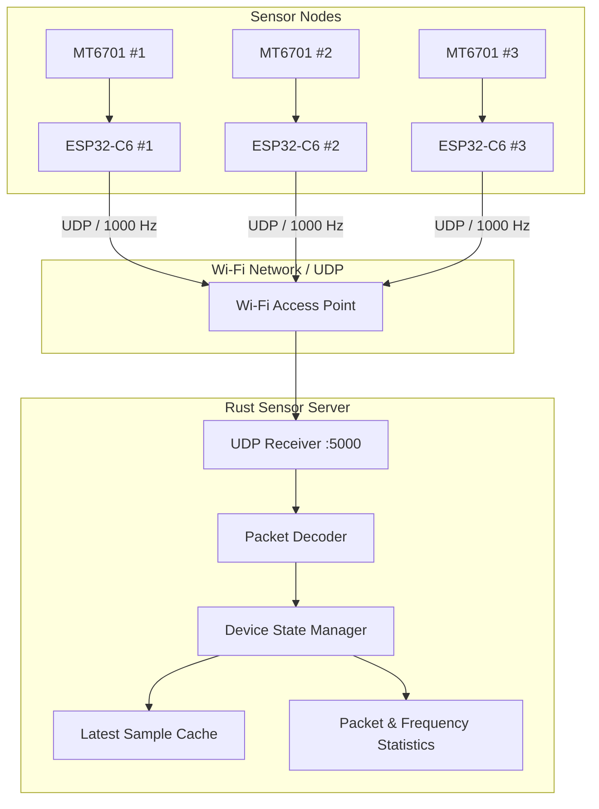
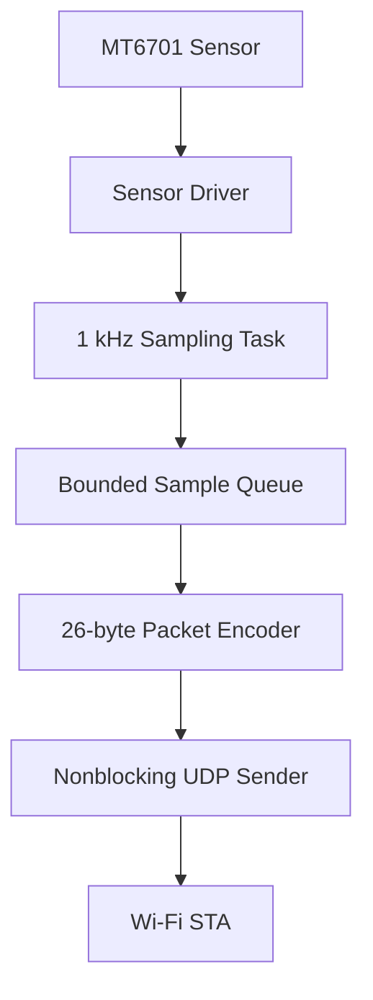
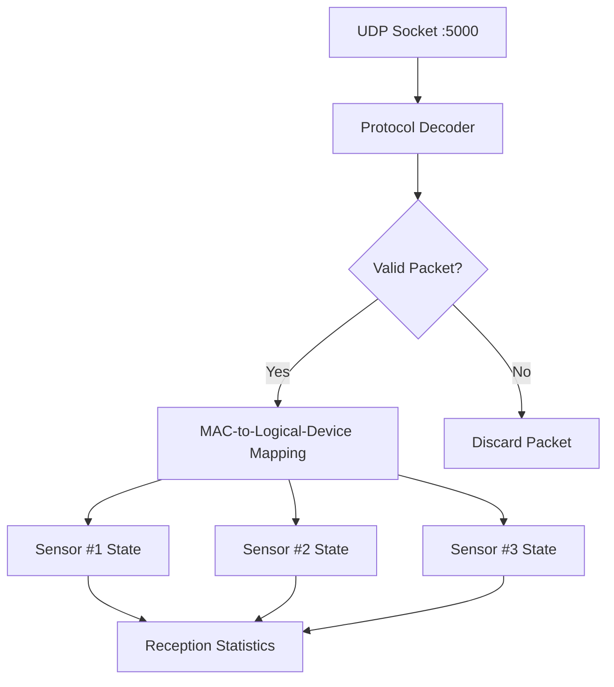
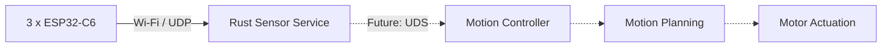

# Sensor System Architecture

## System Overview

The system consists of three ESP32-C6 sensor nodes, each connected to an MT6701 magnetic angle sensor. Each node samples raw angle data at a target frequency of 1000 Hz and transmits it to a centralized Rust Sensor Server over Wi-Fi using UDP.

## ESP32-C6 Firmware Architecture

Each ESP32-C6 runs the same firmware. Its Wi-Fi station MAC is included in each sample packet and identifies the node.

The firmware is responsible for sensor sampling, packet encoding, Wi-Fi connectivity, and UDP transmission.

### Responsibilities

- **Sensor Driver:** Reads the raw 14-bit angle value from the MT6701 over I²C.
- **Sampling Task:** Uses a 1 ms high-resolution timer to target 1000 samples per second.
- **Sample Queue:** Decouples sensor reads from network transmission; samples are dropped when the bounded queue is full or Wi-Fi is disconnected.
- **Packet Encoder:** Encodes each sample into the fixed 26-byte binary format in [`protocol/protocol.md`](../protocol/protocol.md), including the Wi-Fi station MAC.
- **UDP Sender:** Sends one nonblocking UDP datagram per queued sample.
- **Wi-Fi Manager:** Establishes and maintains network connectivity, including reconnection.

## Rust Sensor Server Architecture

The Rust Sensor Server receives UDP packets from all three ESP32-C6 nodes and maintains their latest sensor states independently.

### Responsibilities

- **UDP Receiver:** Listens on UDP port `5000`.
- **Protocol Decoder:** Parses the fixed-length binary packets.
- **Packet Validator:** Validates packet length, magic number, protocol version, packet type, and status fields.
- **Device Mapping:** Maps each packet's MAC address to a configured logical sensor name or role.
- **Device State Manager:** Maintains the latest sample for each sensor node.
- **Statistics:** Tracks packet reception rate, sequence gaps, and packet loss.

## Communication Protocol

### Transport Configuration

| Parameter | Value |
|---|---|
| Transport | UDP / IPv4 |
| Network | Wi-Fi |
| Server Port | 5000 |
| Sampling Rate | 1000 Hz per node (target) |
| Transmission Mode | One packet per sample |
| Packet Size | 26 bytes |
| Byte Order | Big Endian |
| Retransmission | Disabled |

### Packet Format

| Offset | Field | Type | Size |
|---|---|---|---|
| 0 | `magic` | uint16 | 2 bytes |
| 2 | `version` | uint8 | 1 byte |
| 3 | `packet_type` | uint8 | 1 byte |
| 4 | `device_mac` | byte[6] | 6 bytes |
| 10 | `sequence` | uint32 | 4 bytes |
| 14 | `timestamp_us` | uint64 | 8 bytes |
| 22 | `raw_angle` | uint16 | 2 bytes |
| 24 | `status` | uint8 | 1 byte |
| 25 | `reserved` | uint8 | 1 byte |

**Total packet size: 26 bytes.**

The `timestamp_us` field represents the ESP32's local monotonic time in microseconds. The server maps the embedded Wi-Fi station MAC to a logical sensor using its configuration file. Clocks are not synchronized across nodes in the MVP. See [`protocol/protocol.md`](../protocol/protocol.md) for field semantics and status bits.

## Device Identification

All nodes use the same firmware and include their Wi-Fi station MAC in each sample packet. The server configuration maps each observed MAC address to a logical device name or sensor role. The firmware does not carry a per-node numeric ID; adding or remapping a node does not require rebuilding its image.

## 6. MVP Scope

### Included

- MT6701 raw angle acquisition.
- 1000 Hz target sampling rate per node.
- Wi-Fi connectivity and automatic reconnection.
- UDP packet transmission.
- Rust UDP packet reception and validation.
- Independent state management for three sensor nodes.
- Packet reception statistics and sequence-based loss detection.

### Excluded

- Remote device configuration.
- Remote start/stop commands.
- Cross-device clock synchronization.
- Historical data storage.
- Motor control algorithms.
- Unix Domain Socket (UDS) interface.

## Future Integration

The Sensor Server is designed as an independent process, separate from the motion controller.

In a future development phase, the server will expose sensor data through a Unix Domain Socket (UDS), allowing a Python, Rust, or C++ motion controller to consume the latest sensor states.

The separation ensures that sensor acquisition and motion control can evolve independently.

**MVP Acceptance Criteria:** The Rust Sensor Server can continuously receive raw angle measurements from three physical ESP32-C6 nodes, each targeting 1000 samples per second, while reporting per-device reception rates and packet loss statistics.
